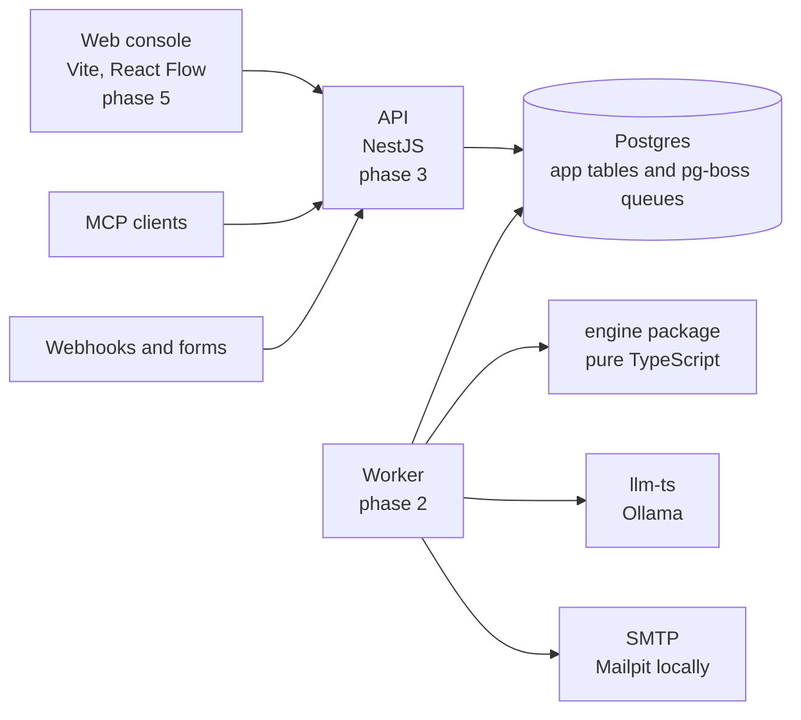

# Daloy

Daloy is a workflow automation engine with AI steps. You build an automation from one trigger and a series of steps, Daloy runs it, keeps a history of every run, and can expose published workflows as MCP tools.

Status: phase 1 done (engine package with tests). See the checklist in [PROJECT.md](PROJECT.md).

## Problem

Small teams do the same multi-step admin work by hand every day: sorting inquiries, chasing unpaid invoices, messaging no-shows. Daloy lets them describe that work once as a workflow and have it run on a webhook, a schedule, a form or a button.

## Screenshots

Added in phase 9.

## Architecture

Planned shape. Parts that do not exist yet are marked with their phase.



## Quickstart

Needs Node 24, pnpm 10 and Docker.

```bash
cp .env.example .env   # then set SECRETS_KEY: openssl rand -base64 32
docker compose up -d
pnpm install
pnpm test
```

Mailpit's inbox is at http://localhost:8025.

## Demo login

Added with the seed script in phase 9.

## Running tests

```bash
pnpm test        # vitest, all packages. Uses DATABASE_URL if set, otherwise starts an embedded Postgres
pnpm typecheck
pnpm lint
```

CI also runs Semgrep, gitleaks and `pnpm audit` on every push.

## Known limitations

- Version 1 supports linear flows with branches only: no loops, no parallel branches, no sub-workflows.
- One workspace per user.
- The web console does not exist yet (phase 5). The API and worker run, but real step types arrive in phase 4.
- Rate limits are counted per API process.

## Dependencies

| Package | Why | License |
| --- | --- | --- |
| zod | Input and definition validation | MIT |
| typescript | Type checking | Apache-2.0 |
| vitest | Test runner | MIT |
| eslint, @eslint/js, typescript-eslint | Linting | MIT |
| @types/node | Node type definitions | MIT |
| drizzle-orm | Typed queries for the application tables | Apache-2.0 |
| drizzle-kit | Generates SQL migrations from the schema | MIT |
| pg, @types/pg | Postgres driver | MIT |
| pg-boss | Job queue on Postgres | MIT |
| tsx | Runs the TypeScript worker without a build step | MIT |
| embedded-postgres | Real Postgres for local tests without Docker | MIT |
| @nestjs/core, @nestjs/common, @nestjs/platform-express | API framework | MIT |
| reflect-metadata, rxjs | Required by NestJS | Apache-2.0, Apache-2.0 |
| @node-rs/argon2 | Password hashing (argon2id) | MIT |
| helmet | Security headers | MIT |
| cookie-parser | Reads the session cookie | MIT |
| supertest | API route tests | MIT |

TypeScript is pinned to 6.0.x because typescript-eslint 8 does not support TypeScript 7 yet.

## How AI was used

Claude Code wrote the code and docs in this repository. The owner reviews each phase, runs the tests and the app, and checks the results before shipping.
