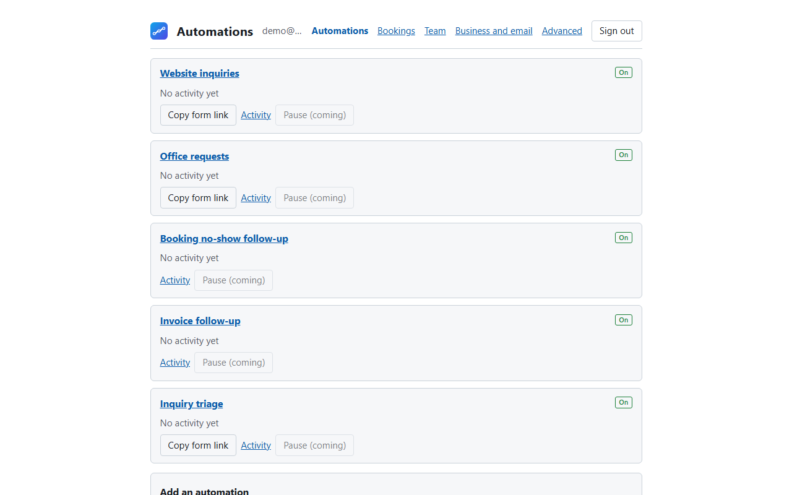
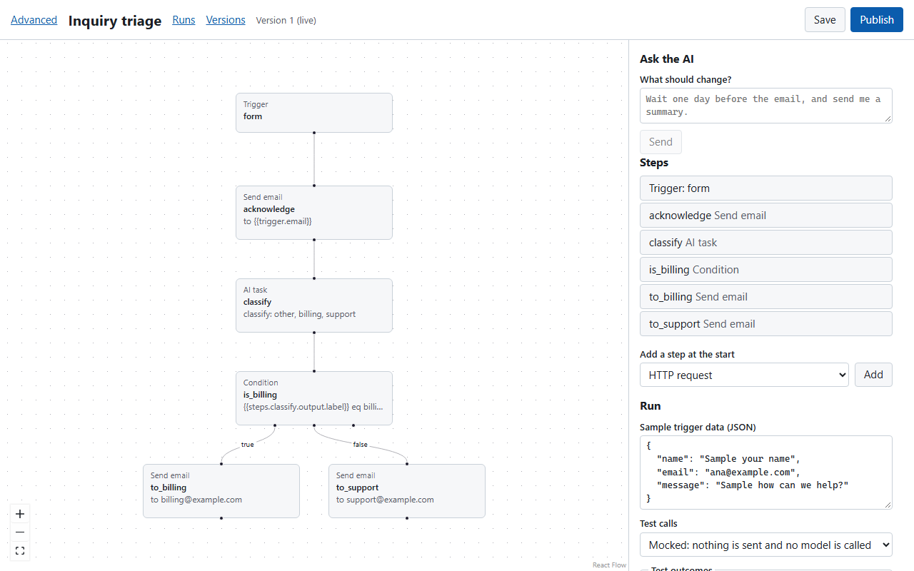
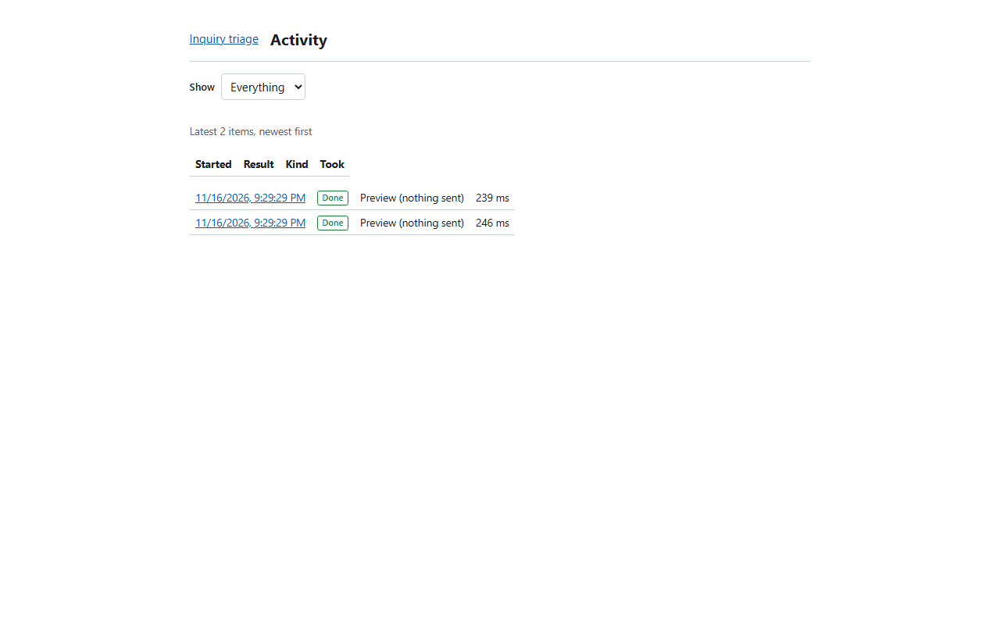
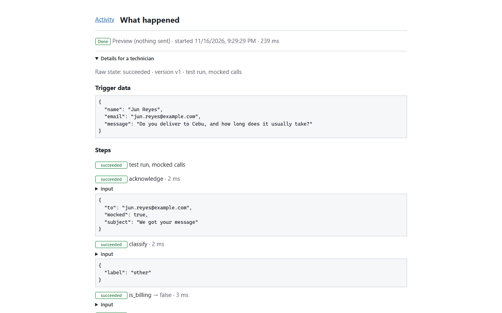
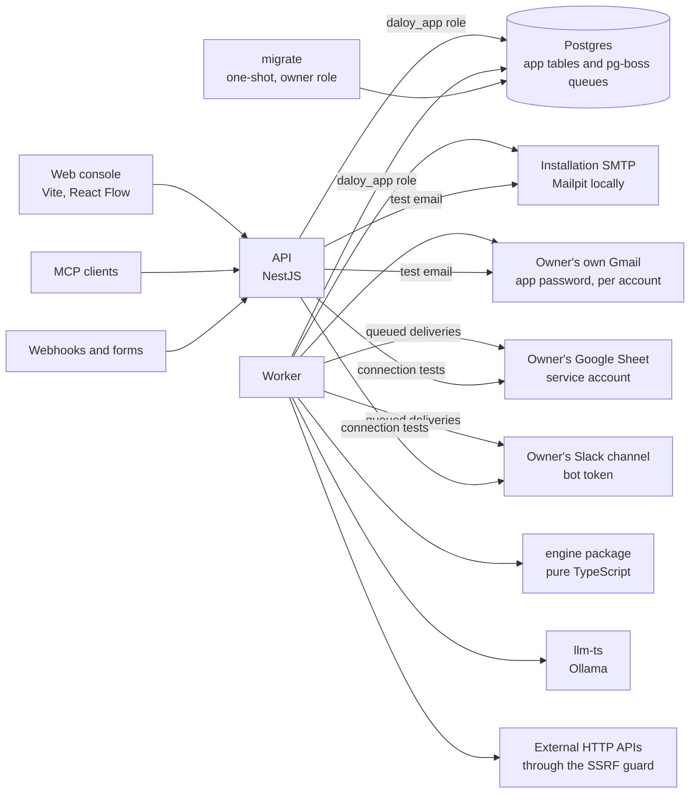

# Daloy

Daloy is a workflow automation engine with AI steps. You build an automation from one trigger and a series of steps, Daloy runs it, keeps a history of every run, and can expose published workflows as MCP tools.

Status: all ten phases in [PROJECT.md](PROJECT.md) are done. CI (lint, typecheck, tests, end-to-end tests, Semgrep, gitleaks, dependency audit and the compose build) passes on GitHub Actions. `docker compose up` and the seed were checked by hand with Docker Desktop on Windows on 2026-11-13.

## Problem

Small teams do the same multi-step admin work by hand every day: sorting inquiries, chasing unpaid invoices, messaging no-shows. Daloy lets them describe that work once as a workflow and have it run on a webhook, a schedule, a form or a button.

## Screenshots

The workflow list of the seeded demo, the builder with the inquiry triage template, a workflow's run history and one run. They are taken by `e2e/demo.spec.ts` (`SCREENSHOTS=1 pnpm e2e`).









## Architecture



The API validates input, stores workflows and starts runs. The worker takes one job per step from pg-boss, runs the step and queues the run again. Sheets rows and Slack notes are rows in a `deliveries` table, which the worker polls and delivers apart from the run. [docs/how-it-works.md](docs/how-it-works.md) explains each part.

## Quickstart

Needs Docker. For development and tests: Node 24 and pnpm 10.

```bash
cp .env.example .env   # then set SECRETS_KEY: openssl rand -base64 32
docker compose up -d
docker compose exec api node_modules/.bin/tsx src/seed.ts
```

The console is at http://localhost:3000 (the API serves it). Mailpit's inbox is at http://localhost:8025. Live AI steps need a model: Ollama on the host by default, or any OpenAI-compatible API such as the Gemini API free tier (`LLM_PROVIDER=openai`, see `.env.example`). Mocked test runs need neither. After changing `.env`, run `docker compose up -d worker`.

Without Docker, the e2e stack runs on an embedded Postgres: start it with `node --input-type=module -e "import s from './e2e/global-setup.ts'; await s()"`, seed it with `SEED_URL=http://localhost:3100 pnpm seed`, and open http://localhost:3100.

To work on the console with hot reload, run the API and worker (`pnpm --filter @daloy/api start`, `pnpm --filter @daloy/worker start`) and then `pnpm --filter @daloy/web dev`. Vite serves it on http://localhost:5173 and forwards API routes to port 3000.

## Demo login

After the seed: `demo@daloy.local`, password `daloy-demo-2026`. The account has the three starter templates (inquiry triage, invoice follow-up, booking no-show follow-up) as published workflows, and five mocked test runs in their run history. It also has **Office requests** ("Track an office request"), turned on and empty: open its form and send a request to see the receipt in Mailpit. Under **Business and email** it has a profile for "Daloy Demo Office" and **Website inquiries** turned on, sending through Mailpit: open the inquiry form, send a message, and find the customer's reply and the office's notification in Mailpit. A new account can try the same template from the home screen: **Try an example** shows a preview that sends nothing, and **Set up for my office** walks through four steps and turns the form on. These are demo credentials for a local install; change or delete the account anywhere else.

## Try the AI

1. Sign in and open **AI model** (top of the workflow list).
2. Pick a provider:
   - **Local model** (Ollama on this computer): run `ollama pull llama3.2` once and keep Ollama running.
   - **Gemini API** (free tier): get a key at Google AI Studio, no credit card. The model is prefilled as `gemini-3.8-flash`; the model field also suggests `gemini-3.6-flash`, `gemini-3.5-flash-lite` and `gemini-4-hydrogen`, which helps when one is overloaded (HTTP 503). Google may use free-tier data to improve its products, so use test data.
   - **OpenAI** or **OpenRouter**: your own key.
3. Press **Save**, then **Test the saved model**. It sends a sample inquiry about a double charge through the same classify prompt the Inquiry triage template uses, and shows the label it got (it should be `billing`), the time and the tokens. If it fails, it says why: model not reachable, key rejected, unknown model name or rate limit.
4. Run the real scenario:
   - Open **Inquiry triage** and follow its **Public form** link.
   - Send a billing question, for example "I was charged twice for my March invoice, please refund one".
   - Then send a product question, for example "The app crashes when I upload a photo".
5. Check the result:
   - Under **Runs**, each run shows the label the model picked and which branch ran.
   - Mailpit (http://localhost:8025) has the thank-you email and the email forwarded to billing@ or support@.

The choice applies to all AI steps in your workflows and takes effect on the next step, without a restart.

## Send real email

By default every email lands in Mailpit (http://localhost:8025) and nobody receives it. Each account can send from its own Gmail address instead:

1. Turn on 2-Step Verification on the Google account, then create an app password ([Google's instructions](https://support.google.com/accounts/answer/185833)).
2. In the console, open **Business and email**, select **Connect Gmail** and enter the Gmail address and the app password.
3. Select **Send a test email to me** and open the link in that email while signed in. Until then nothing is sent from the address.

From then on, that account's published workflows, approval emails and test runs set to "Live" send real mail from its address. Other accounts are not affected. **Disconnect** stops that account's mail until it reconnects; it never switches to another sender. Use your own addresses while testing. The steps for checking this against a real Gmail account are in [docs/live-gmail-check.md](docs/live-gmail-check.md).

The `SMTP_*` settings in `.env` are the installation's own server, used by accounts that connected no Gmail. With Mailpit every account may use it. With any other server only accounts you approve can, each with a daily recipient limit (decision 0024):

1. Keep `SHARED_MAIL` empty or set it to `approved` (`open` would let every sign-up send through your server).
2. Approve a workspace owner, here for 50 recipients a day (UTC):
   ```bash
   docker compose exec postgres psql -U daloy -d daloy -c "update users set shared_mail_daily_limit = 50 where email = 'owner@example.com'"
   ```
   Set it back to `null` to withdraw approval. Sign-up addresses are not verified, so check who owns an account before approving it.
3. Everyone else sends nothing through your server. Their email steps, approval emails and test emails fail with "Connect Gmail", and Business and email says so.

## Google Sheets and Slack

Office requests can also add a row to a Google Sheet and post a short note to a Slack channel. Both are optional, and the local demo works without them. Under **Business and email**, **Connections**:

- Google Sheets: create a service account in a Google Cloud project with the Sheets API turned on, download a JSON key, share the sheet with the service account's email as an Editor, then paste the key, the sheet link and the tab name. **Add a test row** writes one row.
- Slack: create a Slack app with the bot scopes `chat:write` and `channels:read`, install it to your workspace, and paste its bot token (`xoxb-`). Pick a public channel, `/invite` the app there, and **Send a test message**.

Then tick both in the office request's "Where requests and alerts go" step. The worker delivers each row and note on its own, and the Requests list shows each one's state with **Retry**. A Slack note that may already be in the channel asks you to check before posting it again. The steps for checking this against real accounts are in [docs/live-sheets-slack-check.md](docs/live-sheets-slack-check.md).

| Provider | Action | Setup needed | Fixture tests | Live check |
| --- | --- | --- | --- | --- |
| Google Sheets | Add one row per request, reference in column A | Service account key, sheet shared as Editor | Pass (`test/fake-providers.ts`) | Not run |
| Slack | Post reference and subject to one channel | Slack app bot token, app in the channel | Pass (`test/fake-providers.ts`) | Not run |
| Outlook | Send the purchase request emails from the office mailbox | Entra app for the installation, owner's consent (an administrator may have to approve) | Pass (`test/fake-providers.ts`) | Not run, no Microsoft account available |
| Teams | Post reference and item to one channel when a purchase is approved | A Teams Workflows flow "Post to a channel when a webhook request is received" | Pass (`test/fake-providers.ts`) | Not run, no Microsoft account available |

## Outlook, Teams and purchase requests

**Set up purchase requests** on the home screen: staff ask to buy something, the member you name approves or rejects it in Daloy, and approved requests go to purchasing. It runs on the local mail server out of the box. A Microsoft office can also connect, under **Business and email**, **Connections**:

- Outlook: whoever runs Daloy registers a free Microsoft Entra app (redirect URI `<PUBLIC_URL>/settings/connections/outlook/callback`, delegated Graph permissions `Mail.Send`, `User.Read`, `offline_access`) and sets `MICROSOFT_CLIENT_ID` and `MICROSOFT_CLIENT_SECRET` (see `.env.example`). The owner then selects **Connect Outlook** and consents. If their organization only lets administrators approve apps, the panel gives the link to send them.
- Teams: in Teams, create a workflow from "Post to a channel when a webhook request is received" for the channel, and paste its link with the channel's name. **Send a test message** posts once.

Tick them in the template's "Where approved requests go" step. Each email and note is a delivery with its own state and **Retry** in the Requests list. The manual check against real accounts is in [docs/live-microsoft-check.md](docs/live-microsoft-check.md).

## Build a workflow by describing it

1. Pick a model on the **AI model** page and press Test (see above).
2. On the workflow list, write what you want under **Build with AI**, for example:
   "When someone fills my contact form with their name, email and message, thank them by email. If the message is about a payment or invoice, send it to billing@mydomain.com, otherwise to help@mydomain.com."
3. Press **Build draft**. The editor opens on a new workflow the AI drafted. It is not published.
4. Change it by chatting in **Ask the AI**, for example "wait one hour before the thank-you email" or "also send me a one-line summary of each message". The canvas updates after each answer.
5. Check each step, press **Test run draft** (outside calls are mocked), then **Publish**.

The AI only drafts. Nothing runs until you publish, and an invalid draft is refused with the reasons. Small local models get this wrong more often than Gemini or a larger model.

## Running tests

```bash
pnpm test        # vitest, all packages. Uses DATABASE_URL if set, otherwise starts an embedded Postgres
pnpm typecheck
pnpm lint
pnpm e2e         # Playwright: builds the console, starts Postgres, the API and the worker, then runs the browser tests in Chromium
pnpm vitest run apps/api/src/scenarios.test.ts   # the eight QA scenarios: what holds today and each known gap
pnpm reliability:chaos   # 200 runs, the worker killed with SIGKILL ten times
K6=/path/to/k6 pnpm reliability:load   # 1,000 runs started by k6 through the webhook API
```

The first `pnpm e2e` needs a browser: `pnpm exec playwright install chromium`. The load test needs the [k6](https://github.com/grafana/k6/releases) binary (AGPL-3.0, run as a separate program, not bundled). Results of both reliability tests are in [docs/reliability.md](docs/reliability.md).

CI also runs Semgrep, gitleaks and `pnpm audit` on every push.

## Known limitations

- Version 1 supports linear flows with branches only: no loops, no parallel branches, no sub-workflows.
- One workspace per user.
- Gmail is connected with an app password. Accounts that cannot create one (some work and school accounts) cannot send from their own address yet; there is no Google sign-in (OAuth) option.
- The Gmail path is tested against a fake SMTP server only. The live check in [docs/live-gmail-check.md](docs/live-gmail-check.md) has not been run.
- When an account's Gmail stops working, its runs fail with "Reconnect Gmail". There is no button to retry only the failed email after reconnecting.
- Google Sheets and Slack are tested against a local fake only. The live check in [docs/live-sheets-slack-check.md](docs/live-sheets-slack-check.md) has not been run.
- Sheets connects with a service account key, not Google sign-in. Some Google Workspace organisations block creating service account keys.
- One sheet and one Slack channel per account. Only public channels are listed, and only the first 200.
- Outlook and Teams are tested against a local fake only. The live check in [docs/live-microsoft-check.md](docs/live-microsoft-check.md) has not been run, because no Microsoft account was available.
- Outlook needs an Entra app registered for the installation. One mailbox and one Teams channel per account. A Teams note shows "accepted by Teams": Workflows posts it afterwards, and a failure inside the flow only shows in Teams.
- An ambiguous Outlook send waits for Mark as sent or Send again; Daloy has no permission to read Sent Items.
- The purchase request's approval email goes through the Business and email sender, not Outlook.
- An ambiguous Slack post (the call timed out) waits for someone to choose Mark as posted or Post again; Daloy cannot look in the channel.
- A run with Sheets or Slack steps succeeds once the deliveries are queued. Their outcome shows in the Requests list and `GET /deliveries?runId=`, not in the run's own state.
- Saving a website address connects nothing. A client's existing website form keeps working on its own; only Daloy's hosted inquiry form starts the automation.
- AI prompts are tested against a fake model server only. Their accuracy with a real model has not been measured. Delimiting and schema checks limit prompt injection but do not stop a model from choosing a wrong label.
- Anyone who has an unused approval link can approve or reject. The email is the only check on who clicks.
- An approval timeout is picked up by the worker's 15-second sweep, so it can fire up to 15 seconds late.
- Every AI step of a user's workflows uses the one model picked on the AI model page; there is no per-step model.
- The hosted providers (Gemini, OpenAI, OpenRouter) are tested against mocked replies only. The first live call is the owner's own Test with their key.
- The local choice uses whatever the operator set in `LLM_PROVIDER` and `LLM_BASE_URL`; users cannot enter their own server address.
- Run history masks fields by key name. A field called `max_tokens` shows as `[secret]`, and a secret sent in trigger data under an ordinary key name stays visible to the workflow owner.
- Run history lists the latest 50 runs per workflow, with no paging.
- The builder lays out steps automatically and nodes cannot be dragged. Steps are added from the side panel, not by drawing edges.
- The console bundle is about 520 kB (160 kB gzipped), mostly React Flow, React and zod.
- Secret redaction is plain text replacement, so a very short secret value also hides unrelated text that matches it.
- The HTTP step ignores proxy environment variables and only calls ports 80 and 443.
- Rate limits are counted per API process. Signed-in routes count per account and public routes per IP; MCP calls count per IP rather than per token.
- MCP tool calls return as soon as the run is queued. Clients poll `get_run_status` for the result; there are no progress notifications.
- An API token can start every published form workflow of its owner. There are no per-workflow scopes.
- CI only builds the compose images; it does not start the stack. Docker Compose was run by hand once (Docker Desktop on Windows): the `migrate` service exits cleanly, the api and worker connect as `daloy_app`, which cannot create tables, and the seeded demo login works.
- The database role init script only runs when the Postgres volume is created.
- The reliability numbers come from one Windows laptop with one worker process. They show behaviour under load, not capacity.
- The worker advances up to 10 runs at a time. One slow step holds up the rest of its batch until it finishes.

## Dependencies

| Package | Why | License |
| --- | --- | --- |
| zod | Input and definition validation | MIT |
| typescript | Type checking | Apache-2.0 |
| vitest | Test runner | MIT |
| eslint, @eslint/js, typescript-eslint | Linting | MIT |
| @types/node | Node type definitions | MIT |
| drizzle-orm | Typed queries for the application tables | Apache-2.0 |
| drizzle-kit | Generates SQL migrations from the schema | MIT |
| pg, @types/pg | Postgres driver | MIT |
| pg-boss | Job queue on Postgres | MIT |
| tsx | Runs the TypeScript worker without a build step | MIT |
| embedded-postgres | Real Postgres for local tests without Docker | MIT |
| @nestjs/core, @nestjs/common, @nestjs/platform-express | API framework | MIT |
| reflect-metadata, rxjs | Required by NestJS | Apache-2.0, Apache-2.0 |
| @node-rs/argon2 | Password hashing (argon2id) | MIT |
| helmet | Security headers | MIT |
| cookie-parser | Reads the session cookie | MIT |
| supertest | API route tests | MIT |
| nodemailer, @types/nodemailer | SMTP client for email steps, approval mail and the test email (worker and db packages) | MIT-0, MIT |
| react, react-dom, @types/react, @types/react-dom | Console UI | MIT |
| @xyflow/react | Workflow canvas (React Flow) | MIT |
| vite, @vitejs/plugin-react | Console dev server and build | MIT |
| @playwright/test | End-to-end tests | Apache-2.0 |
| @modelcontextprotocol/server | Official MCP server SDK (v2) | Apache-2.0 |
| @modelcontextprotocol/node | Official adapter from the MCP handler to Node and Express; pulls in hono and @hono/node-server (MIT) | Apache-2.0 |
| @modelcontextprotocol/client | Official MCP client, used by the MCP integration and end-to-end tests | Apache-2.0 |

TypeScript is pinned to 6.0.x because typescript-eslint 8 does not support TypeScript 7 yet.
