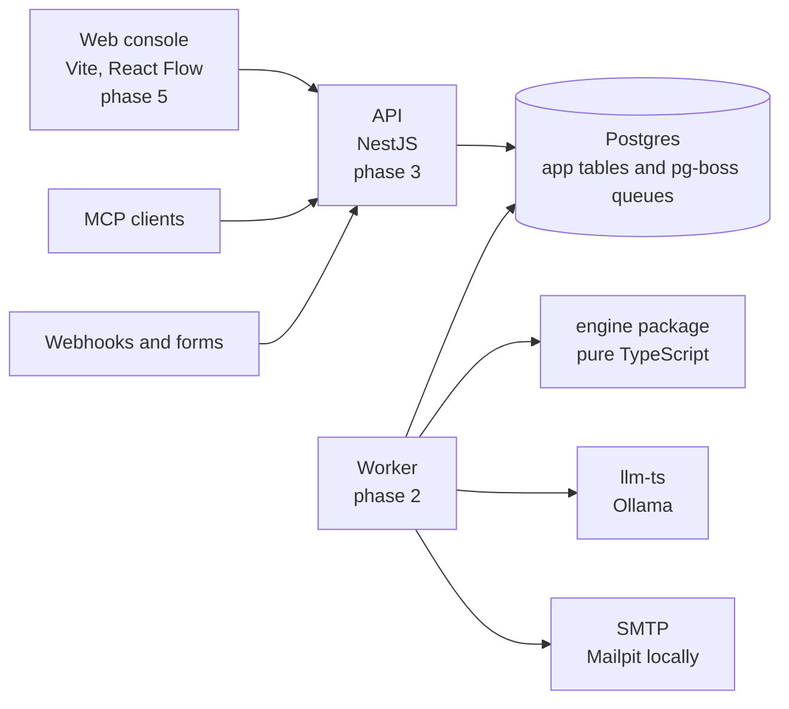

# Daloy

Daloy is a workflow automation engine with AI steps. You build an automation from one trigger and a series of steps, Daloy runs it, keeps a history of every run, and can expose published workflows as MCP tools.

Status: phases 0 to 5 done (engine, worker, API, steps and the builder UI). See the checklist in [PROJECT.md](PROJECT.md).

## Problem

Small teams do the same multi-step admin work by hand every day: sorting inquiries, chasing unpaid invoices, messaging no-shows. Daloy lets them describe that work once as a workflow and have it run on a webhook, a schedule, a form or a button.

## Screenshots

Added in phase 9.

## Architecture

Planned shape. Parts that do not exist yet are marked with their phase.



## Quickstart

Needs Node 24, pnpm 10 and Docker.

```bash
cp .env.example .env   # then set SECRETS_KEY: openssl rand -base64 32
docker compose up -d
pnpm install
pnpm test
```

The console is at http://localhost:3000 (the API serves it). Mailpit's inbox is at http://localhost:8025.

To work on the console with hot reload, run the API and worker (`pnpm --filter @daloy/api start`, `pnpm --filter @daloy/worker start`) and then `pnpm --filter @daloy/web dev`. Vite serves it on http://localhost:5173 and forwards API routes to port 3000.

## Demo login

Added with the seed script in phase 9.

## Running tests

```bash
pnpm test        # vitest, all packages. Uses DATABASE_URL if set, otherwise starts an embedded Postgres
pnpm typecheck
pnpm lint
pnpm e2e         # Playwright: builds the console, starts Postgres, the API and the worker, then runs the main flow in Chromium
```

The first `pnpm e2e` needs a browser: `pnpm exec playwright install chromium`.

CI also runs Semgrep, gitleaks and `pnpm audit` on every push.

## Known limitations

- Version 1 supports linear flows with branches only: no loops, no parallel branches, no sub-workflows.
- One workspace per user.
- The ai and approval step types arrive in phase 7.
- Run history masks fields by key name. A field called `max_tokens` shows as `[secret]`, and a secret sent in trigger data under an ordinary key name stays visible to the workflow owner.
- Run history lists the latest 50 runs per workflow, with no paging.
- The builder lays out steps automatically and nodes cannot be dragged. Steps are added from the side panel, not by drawing edges.
- The console bundle is about 520 kB (160 kB gzipped), mostly React Flow, React and zod.
- Secret redaction is plain text replacement, so a very short secret value also hides unrelated text that matches it.
- The HTTP step ignores proxy environment variables and only calls ports 80 and 443.
- Rate limits are counted per API process.

## Dependencies

| Package | Why | License |
| --- | --- | --- |
| zod | Input and definition validation | MIT |
| typescript | Type checking | Apache-2.0 |
| vitest | Test runner | MIT |
| eslint, @eslint/js, typescript-eslint | Linting | MIT |
| @types/node | Node type definitions | MIT |
| drizzle-orm | Typed queries for the application tables | Apache-2.0 |
| drizzle-kit | Generates SQL migrations from the schema | MIT |
| pg, @types/pg | Postgres driver | MIT |
| pg-boss | Job queue on Postgres | MIT |
| tsx | Runs the TypeScript worker without a build step | MIT |
| embedded-postgres | Real Postgres for local tests without Docker | MIT |
| @nestjs/core, @nestjs/common, @nestjs/platform-express | API framework | MIT |
| reflect-metadata, rxjs | Required by NestJS | Apache-2.0, Apache-2.0 |
| @node-rs/argon2 | Password hashing (argon2id) | MIT |
| helmet | Security headers | MIT |
| cookie-parser | Reads the session cookie | MIT |
| supertest | API route tests | MIT |
| nodemailer, @types/nodemailer | SMTP client for the email step | MIT-0, MIT |
| react, react-dom, @types/react, @types/react-dom | Console UI | MIT |
| @xyflow/react | Workflow canvas (React Flow) | MIT |
| vite, @vitejs/plugin-react | Console dev server and build | MIT |
| @playwright/test | End-to-end tests | Apache-2.0 |

TypeScript is pinned to 6.0.x because typescript-eslint 8 does not support TypeScript 7 yet.

## How AI was used

Claude Code wrote the code and docs in this repository. The owner reviews each phase, runs the tests and the app, and checks the results before shipping.
